# 数码考古馆 · AI 讲解员（360° 实景版）

> 2026 软工实践周参赛作品 · 初级组（大一）· 主题「数码」
> 一间会自己带路的 360° 数字博物馆：你说想看什么，AI 讲解员会自己转头、变焦、带你走到展品前讲解。

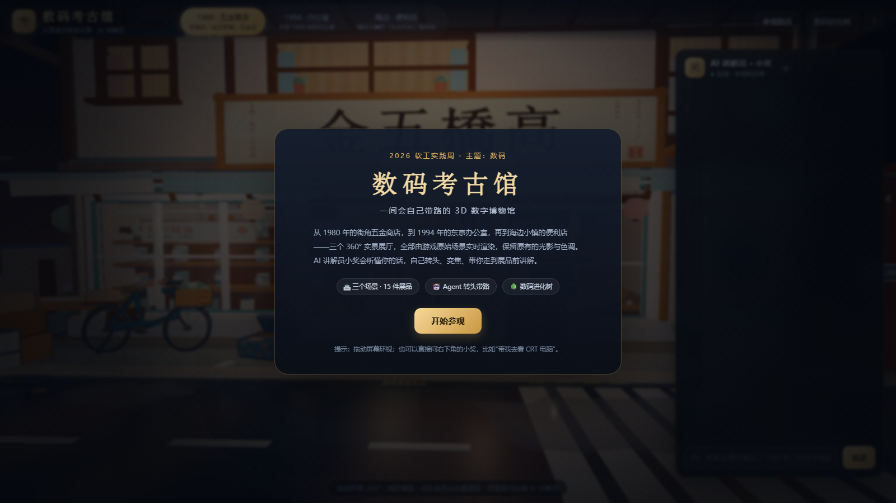

## 这是什么

从 1980 年的街角五金商店，到 1987 年的海边便利店，再到 1994 年的东京办公室——**三个 360° 展厅，全部由游戏原始场景实时渲染**，保留游戏里的原始光影、色调、天空与后期。年代与器物做过考据，见 [docs/年代考据.md](docs/年代考据.md)。

- **1980 · 五金商店**：电视、收音机、公用电话、算盘、台扇——数码进入家庭的前夜
- **1987 · 海边便利店**：自动售货机、收银台与条码、冷柜、自动门、灯塔——零售与公共设施的数字化（1987 年可同时容纳这些器物，详见考据）
- **1994 · 办公室**：CRT 台式电脑、软盘与软驱、传真机、电子计算器、挂钟——办公室数字化
- **15 件展品 · 15 张展品卡**：年代、当年价格、生活影响，全部为可点击的 3D 空间热点
- **AI 讲解员「小奖」**：不是聊天框套壳，而是能操作视角的 Agent——听懂人话后调用工具：切换展厅、转头、变焦、高亮展品，再开口讲解
- **老式摄像机**：进入 4:3 取景，拖动环视、WASD 移动机位、滚轮变焦、空格拍照；画面带 VHS/Video8/Hi8 质感与当年日期戳
- **使用模拟**：15 件展品全部可「使用」——电视开机换台、计算器真的能算、售货机投币出货、传真机发报、冷柜开门、灯塔点亮……音效由浏览器实时合成
- **默认自由视角**：进入展厅后可用 WASD / 方向键前后左右移动机位（Shift 加速），拖动环视，滚轮缩放
- **AI 参与调参**：摄像机模式下可以直接说「拉近一点 / 调亮一点 / 颗粒少一点」，Agent 会改镜头参数；也有曝光 / 颗粒 / 暖色滑杆
- **专家模式**：焦距（24–85mm）、光圈（f/1.4–16）、快门（1/8–1/1000s）、ISO（100–6400）、白平衡（2800–7500K）、曝光补偿、饱和度、对焦——真实相机参数直接影响画面（曝光/噪点/拖影/暗角/色调）
- **AI 指导 + 风格调参**：摄像机旁有 AI 指导面板，输入「我想要 1987 年家庭录像的感觉」或点风格按钮，AI 会把整套参数调好并解释
- **看展品更近**：每件展品按物件大小设置镜头拉近（fov 16–26），点光点或说「带我去看」都能看清物件

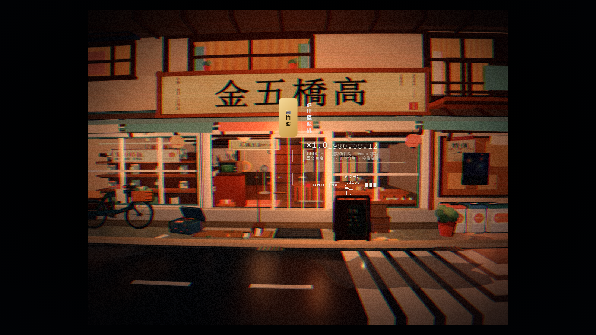
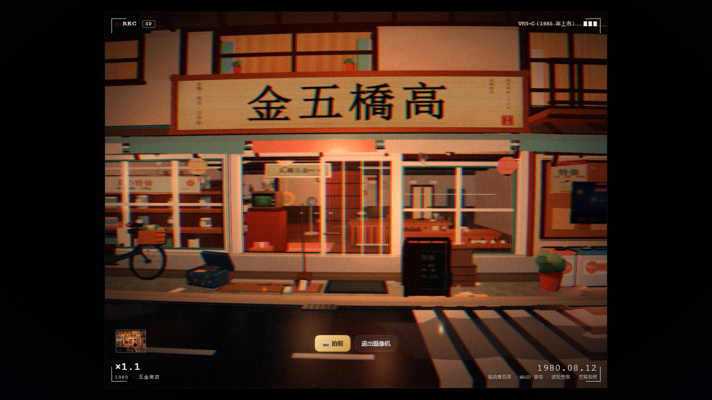
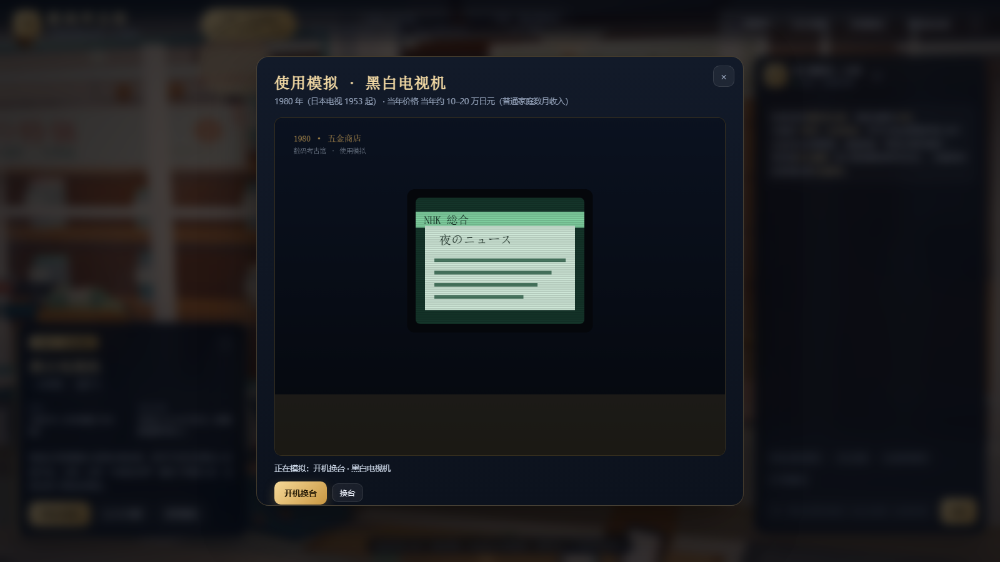
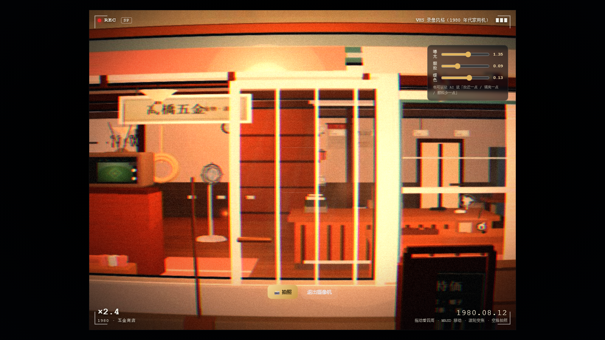
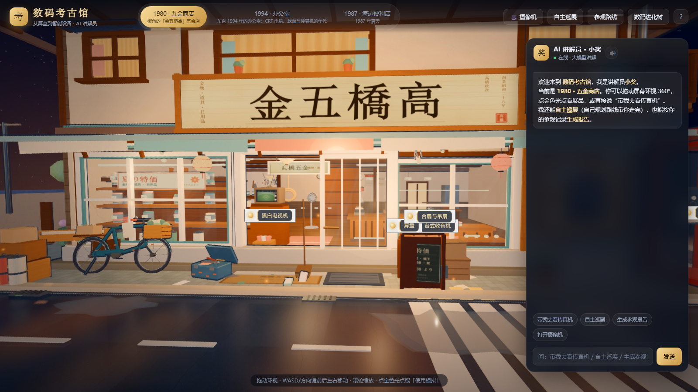
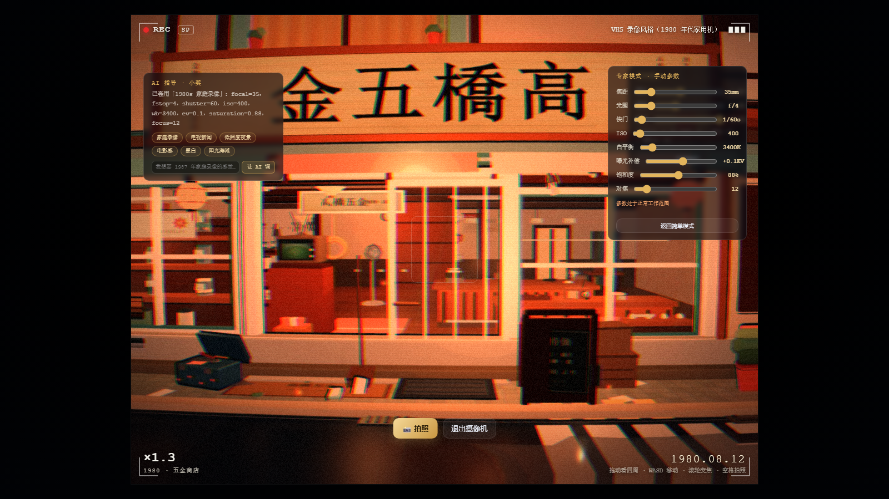
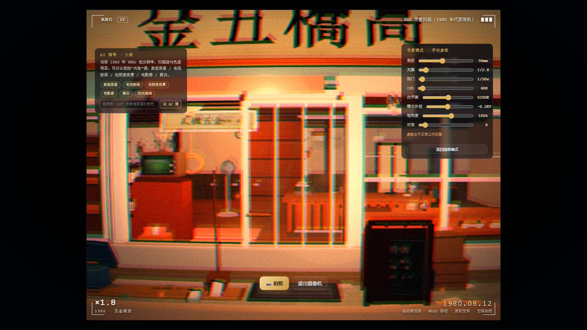

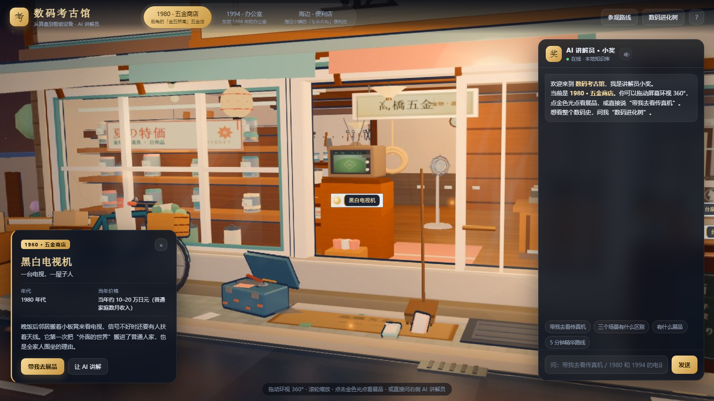
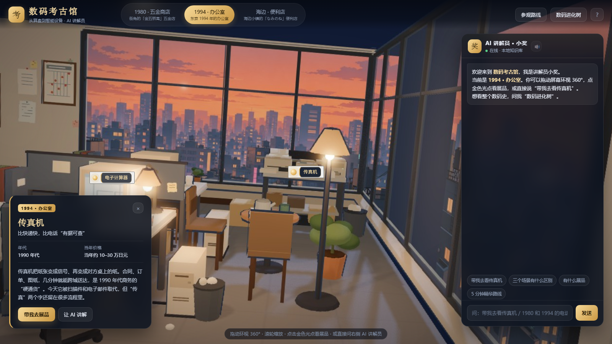
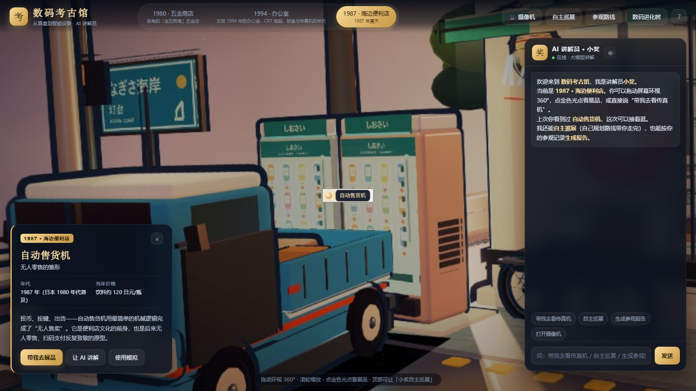

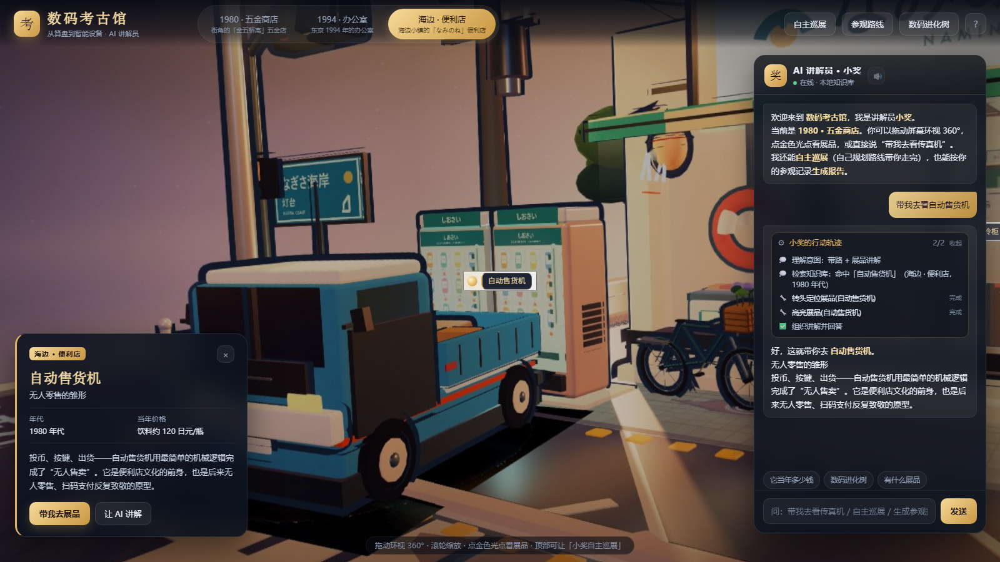
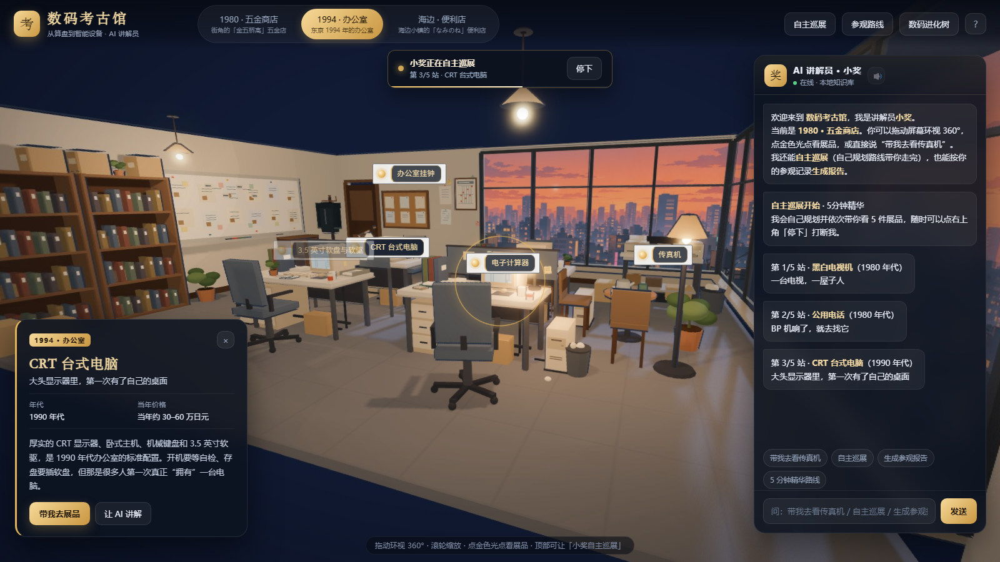
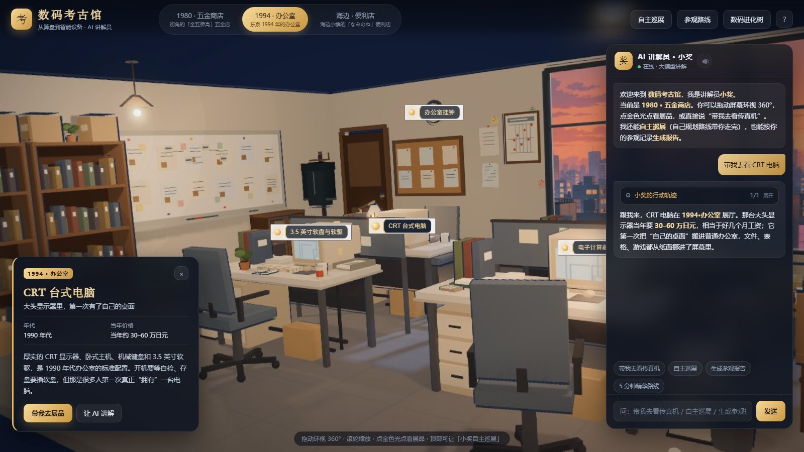
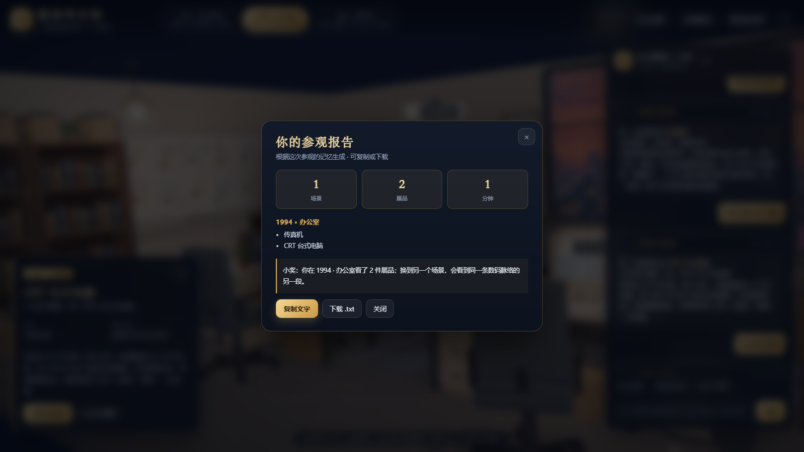

## 为什么"光影是原来的"

我们**没有在网页里重新打光**。做法是：

1. 用 Godot 4.7.2 加载游戏里的原始场景（把 `tools/lead_pano_render.gd` 复制到 life 项目的 `tools/` 下，以 `res://tools/lead_pano_render.gd` 运行）（`res://scenes/main.tscn`、`office_1994_corner.tscn`、`mart.tscn`），等场景脚本完成建模/打光/上色；
2. 用脚本 `tools/lead_pano_render.gd` 在场景内固定机位渲染 **6 个 90° 立方体面**（保留原场景的灯光、卡通描边、天空 shader、后期）；
3. 用 `tools/stitch_pano.py` 拼成 6144×3072 的等距柱状全景图；
4. 网页端用一个球体 + 自定义 equirect 采样 shader 呈现，视角由 yaw/pitch 控制，展品热点来自 Godot 导出的节点世界坐标。

所以你在网页里看到的每一帧，都是游戏场景在 Godot 里的原始渲染结果。

## 老式摄像机模式（自由取景 + 拍照）

点顶部「🎥 摄像机」或对 Agent 说“打开摄像机”，进入 4:3 取景：

- **自由移动**：WASD / 方向键移动机位（在场景内小幅游移，避免破坏全景视差），鼠标拖动自由摆动镜头，滚轮光学变焦
- **手持感**：模拟手持呼吸/走动的细微晃动（yaw/pitch/roll）
- **老镜头画面**：自定义后处理 shader —— 桶形畸变、色差（VHS 色度分离）、扫描线、磁带颗粒、低对比暖调、暗角、行抖动
- **取景信息**：REC / SP / BATT / 日期戳 / 变焦倍数 / 胶卷张数，按展厅年份显示（1980 VHS、1987 Video8、1994 Hi8）
- **拍照**：空格或「📸 拍照」，输出 1440×1080 JPEG（4:3），画面带日期戳与取景信息，自动下载并保留在左下角底片条

> 摄像机是「风格化复刻」，用于还原 1980–90 年代家用录像观感，不对应具体型号；各展厅的设备标注与年代依据见 [docs/年代考据.md](docs/年代考据.md)。

## Agent 能做什么

| 能力 | 例子 | 对应工具 |
|---|---|---|
| 带路 + 讲解 | "带我去看自动售货机" | `switchEra` → `goto`（转头+变焦） |
| 场景切换 | "带我去 1994 办公室" | `switchEra` |
| 器物/年代对比 | "算盘和计算器有什么不同" | 知识库 + `goto` |
| 主题路线 | "给我 5 分钟精华路线" | `openRoute` / `startRoute` |
| 数码进化树 | "数码是怎么进化的" | `openEvolution` |
| 价格/背景问答 | "它当年多少钱" | 展品知识库 |
| 自主巡展 | "你自我规划，自己带我走完" | `startTour`（前端逐站执行） |
| 记忆 + 参观报告 | "生成参观报告" | `openReport` + localStorage 访问记忆 |
| 打开老式摄像机 | "打开摄像机 / 拍一张" | `openCamera`（进入取景/快门） |
| 摄像机调参 | "拉近一点 / 调亮一点" | `camera`（zoom / exposure / grain / warm） |
| 展品使用模拟 | "用一下传真机 / 电视机怎么用" | `simulate`（15 种器物交互） |
| 风格化调参 | "我想要电影感 / 家庭录像的感觉" | `cameraStyle`（真实相机参数组合） |
| 专家参数说明 | "ISO 调高会怎样" | 专家模式 + AI 指导面板 |
| 拍照识别（规划中） | 上传老设备照片识别型号 | 多模态模型 |

实现要点：

- **工具调用**：LLM（或本地规则引擎）输出 `{reply, plan, actions}`，前端执行动作（白名单校验，≤6 步），并逐条打勾展示在「行动轨迹」里
- **本地兜底**：没有 API Key / 断网时自动切换规则引擎，现场演示永不翻车
- **可解释**：所有动作都有 schema，见 `server/serve.py` 的系统提示词
- **记忆**：`localStorage` 保存浏览/提问记录，供「上次」问答与参观报告使用

## Agent 工程化：轨迹、记忆、自主巡展与评测

这一版把「Agent 开发」补成了可演示、可度量的东西：

- **规划轨迹可见**：每条回答上方有「小奖的行动轨迹」——理解意图 → 检索知识库 → 调用工具（切展厅 / 转头定位 / 高亮）→ 组织回答；执行时逐步打勾，可展开/收起。评委能看到 Agent 怎么想、怎么动手。
- **有记忆**：展品浏览、提问、开场时间记录在 localStorage；再次打开会主动说"上次你看到过 ××"，问"上次我看了什么"能回忆，多轮对话保留上下文。
- **自主巡展**：点顶部「自主巡展」，Agent 自己规划路线、自己切场景、自己逐站讲解，进度条显示"第 N/5 站"，随时可「停下」；结束后自动生成参观报告。
- **参观报告**：按实际参观记录生成统计、时间线和一句话总结，可复制文字或下载 .txt。
- **可度量**：`node tools/eval_agent.mjs` 跑 24 条中文指令评测（带路 / 切场景 / 对比 / 价格 / 进化树 / 路线 / 巡展 / 报告 / 记忆 / 兜底），校验工具选择与回答要点，输出通过率和时延，报告写到 [docs/评测报告.md](docs/评测报告.md)。

当前结果（同一套 24 条用例，两条路径都跑过）：

| 路径 | 通过率 | 平均时延 | P95 时延 | 报告 |
|---|---|---|---|---|
| 本地规则引擎（无 Key / 断网兜底） | **100%**（24/24） | 0.15 ms | 0.53 ms | [docs/评测报告.md](docs/评测报告.md) |
| 大模型 DeepSeek（deepseek-chat，真实网络） | **100%**（24/24） | **1.48 s** | **1.74 s** | [docs/LLM评测报告.md](docs/LLM评测报告.md) |

> 本地路径保证演示永不翻车；大模型路径提供更自然的讲解。同一条 `respond()` 接口，前端无感知切换。

## 使用模拟（15 件展品）

每件展品都能「用一下」，不是看静态图：

| 展厅 | 模拟内容 |
|---|---|
| 1980 五金商店 | 黑白电视开机/换台（雪花与NHK台标）、收音机调台（沙沙声）、算盘拨珠、投币电话拨号、台扇换挡 |
| 1994 办公室 | CRT 开机自检、软盘插入读取、传真发报（调制解调器声）、计算器真实运算、挂钟走时 |
| 1987 海边便利店 | 售货机投币出货、条码扫码（嘀声）、冷柜开门冷气、自动门感应、灯塔光束旋转 |

实现：`js/simulator.js`，Canvas 逐帧绘制 + Web Audio 实时合成音效（无外部素材）；展品卡加「使用模拟」按钮，Agent 也能用 `simulate` 动作打开。

## 自由视角与专家模式

- **默认自由视角**：进入展厅即可用 `WASD` / 方向键前后左右移动（`Shift` 加速），鼠标拖动环视，滚轮缩放；活动范围限制在小幅游移内，避免破坏全景视差。
- **摄像机模式**：4:3 VHS/Video8/Hi8 取景 + 拍照，带 REC/SP/BATT/日期戳。
- **专家模式**：真实相机参数（焦距、光圈、快门、ISO、白平衡、曝光补偿、饱和度、对焦）→ 画面联动：
  - 焦距 → 视角（fov），换算按 36mm 全画幅等效；
  - ISO → 颗粒与亮度；快门 → 拖影与曝光；光圈 → 暗角；白平衡 → 冷暖；
  - 参数越界会给出警告（过曝 / 噪点 / 拖影）。
- **AI 指导**：面板实时给出当前风格建议；点「家庭录像 / 电视新闻 / 低照度夜景 / 电影感 / 黑白 / 阳光海滩」预设，或输入一句话（如“我想要电影感、稍微暗一点”），AI 会换算并套用整套参数。

## 技术架构

```
浏览器（Three.js r160）
 ├─ 360° 实景（equirect 全景 + 自定义采样 shader）
 ├─ 空间热点（Godot 导出的 yaw/pitch） / 展品卡 / 进化树 / 参观路线
 └─ 聊天面板 ──POST /api/chat──▶ Python 本地服务（server/serve.py）
                                  ├─ 有 Key：调用 OpenAI 兼容大模型（DeepSeek / 火山方舟）
                                  └─ 无 Key：/api/chat 返回 503，前端自动用本地规则引擎
```

- 前端纯静态（HTML/CSS/ESM + Three.js），无构建步骤
- 后端零第三方依赖（Python 标准库），只做静态托管与 LLM 代理
- Key 只存在后端环境变量，**绝不下发到浏览器**

## 快速运行

需要：Python 3.10+，Chrome/Edge。

```bat
:: 双击 start.bat 即可（自动启动服务、等就绪后用 Chrome/Edge 打开）
:: 或命令行：
cd /d "D:\Download\Deepseek Working\数码考古馆"
python server\serve.py --port 8787
:: 打开 http://127.0.0.1:8787
```

> 必须通过本地服务器打开（不要双击 index.html），否则浏览器会拦截 JSON/图片的 fetch。

### 启用大模型讲解（可选，3 分钟接入）

支持两种方式，任选其一。**Key 只写进本机 `.env`（已加入 .gitignore），只在服务端使用，不会下发到浏览器。**

#### 方式 A：DeepSeek 官方 API（最省事）

1. 打开 https://platform.deepseek.com 注册 / 登录；
2. 左侧「API Keys」→ 创建，复制 `sk-` 开头的 Key；
3. 双击项目里的 **`配置大模型.bat`**（自动生成 `.env` 并用记事本打开）；
4. 把 `DEEPSEEK_API_KEY=sk-你的DeepSeekKey` 换成你的 Key，保存；
5. **刷新浏览器页面**（服务已热加载 `.env`，不用重启），右下角变成「在线 · 大模型讲解」即接入成功。

> 如果第 5 步仍显示「本地知识库」：说明当前服务进程是用旧代码启动的（热加载是后加的），关掉服务窗口重新双击 `start.bat` 一次即可；之后改 `.env` 都只需刷新页面。
>
> 常见错误：Key 只写在 `.env.example` 里（要写进 `.env`）；把整行 `DEEPSEEK_API_KEY=` 注释掉了；Key 前后带空格/引号（脚本会去掉首尾引号）。

#### 方式 B：火山方舟（豆包 / DeepSeek 等）

1. 打开 https://console.volcengine.com/ark 开通方舟，创建推理接入点（或直接用模型 ID）；
2. 在 `.env` 里填：
   ```ini
   ARK_CODING_API_KEY=你的火山方舟Key
   ARK_MODEL=ep-xxxxxxxx
   ARK_BASE_URL=https://ark.cn-beijing.volces.com/api/v3
   ```
3. 重启 `start.bat`。

#### 命令行方式（和 `.env` 等价）

```bat
set DEEPSEEK_API_KEY=sk-xxxx
python server\serve.py --port 8787
```

#### 验证是否接入成功

```bat
:: 1) 健康检查：llm 应为 true，并返回 provider / model
curl http://127.0.0.1:8787/api/health

:: 2) 页面右下角状态应为「在线 · 大模型讲解」
:: 3) 跑一遍 LLM 模式评测，生成 docs/LLM评测报告.md
node tools/eval_llm.mjs
```

未配置 Key 时右下角显示「本地知识库」，全部演示功能仍可用（自动兜底，不会翻车）。

## 分享给别人（体验链接）

- **完整版 zip**：对方装 Python 3.10+，解压双击 `start.bat`，打开 `http://127.0.0.1:8787`（不含密钥，大模型可选自行配置）。
- **静态版 zip**（3.2MB，纯前端、无需服务器/Key）：直接上传到 Vercel / Cloudflare Pages / GitHub Pages，得到一个公网链接；AI 讲解员自动走本地知识库，其余功能与大模型版一致。
- **局域网演示**：`python server/serve.py --host 0.0.0.0 --port 8787`，同一 Wi-Fi 用 `http://你的IP:8787`。
- **公网保留大模型**：把 `server/serve.py` 部署到容器并配 Key + 限流，不能让 Key 落到前端。

详见 [docs/部署与分享.md](docs/部署与分享.md)。

## 目录结构

```
数码考古馆/
├─ index.html            页面骨架（含 importmap、引导/帮助）
├─ css/style.css         博物馆深色视觉
├─ js/app.js             全景查看器、热点、视角动画、聊天、路线
├─ js/agent.js           本地规则 Agent + LLM 后端调用
├─ data/exhibits.json    3 个场景 / 15 件展品 / 进化树 / 参观路线
├─ assets/pano/          三个 6144×3072 全景图（Godot 渲染）
├─ libs/three.module.js  three.js r160
├─ server/serve.py       静态服务 + /api/chat LLM 代理
├─ tools/
│  ├─ lead_pano_render.gd  Godot 端：场景 → 6 立方体面 + 节点坐标（复制到 life 项目 tools/ 下运行）
│  ├─ stitch_pano.py       立方体面 → 等距柱状全景
│  ├─ build_pano_data.py   节点坐标 → 热点 yaw/pitch + data/exhibits.json
│  ├─ eval_agent.mjs       Agent 评测·本地引擎（24 条指令）
│  ├─ eval_llm.mjs         Agent 评测·大模型模式（同一套用例）
│  ├─ eval_cases.mjs       共用评测用例
│  └─ shot.mjs             Chrome CDP 截图/自动化测试
├─ shots/                真实运行截图
├─ .env.example          大模型配置模板（复制为 .env 填写 Key）
├─ 配置大模型.bat         一键生成 .env 并用记事本打开
└─ start.bat             一键启动
```

## 重新生成全景（需要本机 life 项目 + Godot 4.7.2）

```powershell
# 1) Godot 渲染 6 个立方体面 + nodes.json
& "D:\平台\Godot_v4.7.2-stable_win64.exe\Godot_v4.7.2-stable_win64_console.exe" `
  --path "C:\Users\蔡璟熙\Documents\life\godot-game" `
  --script "res://tools/lead_pano_render.gd" -- `
  "res://scenes/office_1994_corner.tscn" "D:\...\pano\office" 2048 50 scene scene

# 2) 拼接全景
python tools/stitch_pano.py pano\office pano\office_pano.jpg 6144

# 3) 生成展品热点与数据
python tools/build_pano_data.py
```

> 三个场景的机位：商店 `0.4,1.7,7.6 → 0.2,1.4,0.6`；办公室用场景自带相机；便利店 `0.4,1.8,8.4 → 0.4,1.2,0.0`。

## 素材来源与许可（重要）

- 三个场景均来自本机 `Documents\life` 的自建项目（含 Tripo 生成的角色/资产），参赛与校园演示可用。
- 公开 GitHub 仓库只提交**代码 + 自产/CC0 素材**；第三方付费素材不进仓库，README 注明"需自行获取"。全景图体积小，可随仓库提交。
- 若用于线上公开部署，请再核对一次素材许可（校园比赛一般无碍，商业发布需逐项确认）。

## 性能与部署

- 全景图各 0.5–1.6MB，按场景懒加载；低端设备也能流畅运行（不再需要实时 3D 渲染）
- 部署：前端静态托管（Vercel / Cloudflare Pages / 国内静态托管）+ 1 个免费容器跑 `server/serve.py`；**必须测游客未登录可访问**
- 首屏建议默认进入 1980 商店（光影最完整），加载提示已内置

## 答辩演示脚本（8 分钟）

详见 [docs/答辩演示脚本.md](docs/答辩演示脚本.md)。

## 当前进度 & 待办

- [x] 三个 Godot 原场景 → 360° 全景（保留原始光影）
- [x] 15 件展品卡 + 数码进化树 + 四条参观路线
- [x] 三个展厅年代考据：1980 / 1987 / 1994，逐件核对（见 docs/年代考据.md）
- [x] 老式摄像机模式：自由取景、WASD 移动、变焦、VHS/Video8/Hi8 后处理、拍照下载
- [x] Agent 工具 + 本地兜底 + LLM 代理接口
- [x] Agent 规划轨迹可视化（工具调用过程可见）
- [x] 参观记忆 + 参观报告（复制 / 下载）
- [x] 自主巡展模式（自己规划、自己走完、可打断）
- [x] Agent 评测集 24 条，通过率 100%（见 docs/评测报告.md）
- [x] 真实运行截图（1600×900，Chrome CDP 自动截图）
- [x] 大模型接入（`.env` / 环境变量，DeepSeek 与火山方舟，占位 Key 自动识别）
- [x] 配置真实 Key 跑通 LLM 模式，并出《LLM评测报告》（DeepSeek，24/24，平均 1.48s）
- [ ] 官方海报模板出来后做海报
- [ ] 3 分钟演示视频（B 站）
- [ ] 周四 12:00 前提交：作品信息 / 海报 / 仓库链接 / 视频链接 / 体验链接
- [ ] 周五答辩彩排（8 分钟控时）
